# Jarkom-Modul-3-2026-K-35

----
| Nama | NRP |
| ---------------------- | ---------- |
| Dea Chrisna Butarbutar | 5027251035 |
| Pradipta Airlangga Ramadhan | 5027251118 |
----

# IP Address Host : 10.4.89.247

# IP Prefix : 10.81.x.x

# Curtain Protocol: Shibuya Incident

Author: Author: alchemiststs & deefen

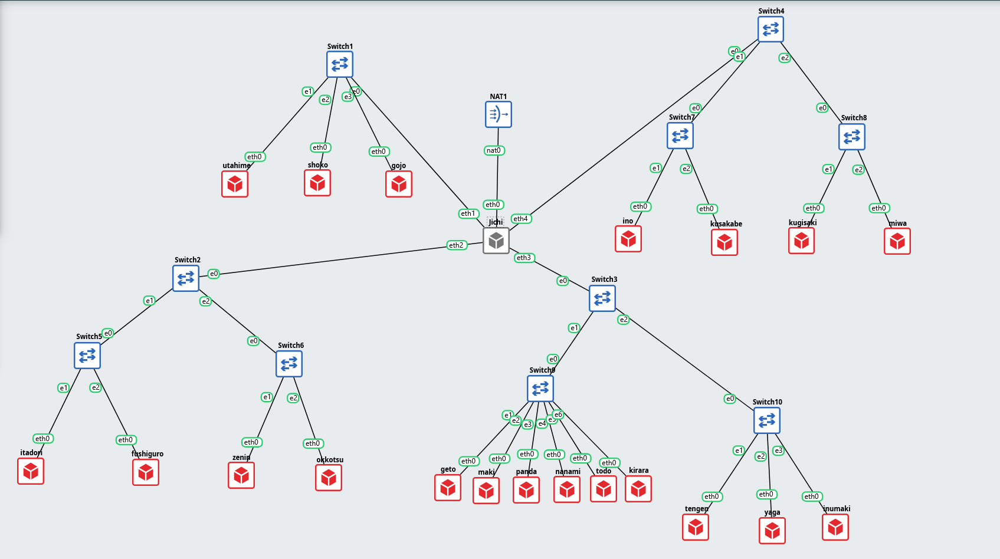

Glosarium Entitas:
jichi: Router Utama & DHCP Relay
tengen: DHCP Server 
utahime: DNS Master 
shoko: DNS Slave
gojo: Public Reverse Proxy (nginx) 
itadori, fushiguro: Klien DHCP Pool 1
zenin, okkotsu: Klien DHCP Pool 2
ino, kusakabe: Klien short lease
miwa: Klien long lease
kugisaki: Klien fixed address
geto: Internal Load Balancer (nginx)
maki, panda: Worker frontend 
nanami, todo: Worker API utama
kirara: Worker API cadangan 
yaga: Database Master MariaDB
inumaki: Database Slave MariaDB
<K035>

## Soal_1
Ketika Curtain menutup Shibuya, jalur komunikasi antar zona Jujutsu High terputus. Pulihkan konektivitas dasar dengan mengonfigurasi jichi: eth0 memperoleh WAN dari NAT, sedangkan eth1–eth4 menjadi gateway Network 1–4 sesuai tabel pemetaan. Aktifkan IPv4 forwarding dan source NAT, lalu tetapkan IP statis host infrastruktur sesuai tabel spesifikasi. Buktikan konektivitas setiap host ke gateway dan akses eksternal dari host yang relevan.

jichi berperan sebagai router sentral. Router bekerja dengan cara meneruskan paket dari satu jaringan ke jaringan lain. Agar bisa melakukan ini, jichi membutuhkan:

1. Satu interface yang terhubung ke internet (eth0 via NAT)

2. Empat interface yang menjadi “pintu masuk” ke masing-masing jaringan internal (eth1-eth4)

3. IP Forwarding aktif agar paket bisa diteruskan antar interface

4. NAT Masquerade agar semua host internal bisa akses internet menggunakan IP jichi.

Konfigurasi Interface jichi
```
auto lo
iface lo inet loopback

auto eth0
iface eth0 inet dhcp

auto eth1
iface eth1 inet static
    address 10.81.1.1
    netmask 255.255.255.0

auto eth2
iface eth2 inet static
    address 10.81.2.1
    netmask 255.255.255.0

auto eth3
iface eth3 inet static
    address 10.81.3.1
    netmask 255.255.255.0

auto eth4
iface eth4 inet static
    address 10.81.4.1
    netmask 255.255.255.0
```

Selanjutnya kita perlu mengaktifkan IP Forwarding jichi. IP Forwarding adalah kemampuan kernel Linux untuk “meneruskan” paket yang masuk dari satu interface ke interface lain. Secara default, Linux tidak melakukan ini karena komputer biasa bukan router. Kita harus mengaktifkannya secara eksplisit.

```
sysctl net.ipv4.ip_forward
```

Lalu untuk tahap selanjutnya kita perlu Konfigurasi NAT Masquerade. NAT Masquerade membuat semua paket dari jaringan internal yang keluar ke internet seolah-olah berasal dari IP eth0 jichi. Tanpa ini, paket bisa keluar tapi balasannya tidak akan sampai karena IP internal (10.81.x.x) tidak dikenal di internet.

```
iptables -t nat -A POSTROUTING -o eth0 -j MASQUERADE
```
Tambahkan resolver agar jichi sendiri bisa resolve domain.

```
echo "nameserver 192.168.122.1" > /etc/resolv.conf
```

Verifikasi akses internet dari jichi
```
ping -c 3 8.8.8.8
```
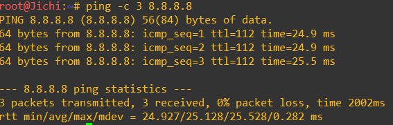

Tahap berikutnya kita perlu Konfigurasi IP Statis Network 1 (utahime, shoko, gojo).
Ketiga node ini berada di Network 1 (subnet 10.81.1.0/24). Mereka mendapat IP statis karena sebagai server DNS dan reverse proxy.

Shoko
```
auto lo
iface lo inet loopback

auto eth0
iface eth0 inet static
    address 10.81.1.3
    netmask 255.255.255.0
    gateway 10.81.1.1
```

utahime
```
auto lo
iface lo inet loopback

auto eth0
iface eth0 inet static
    address 10.81.1.2
    netmask 255.255.255.0
    gateway 10.81.1.1
```

gojo
```
auto lo
iface lo inet loopback

auto eth0
iface eth0 inet static
    address 10.81.1.3
    netmask 255.255.255.0
    gateway 10.81.1.1
```

tengen

```
auto lo
iface lo inet loopback

auto eth0
iface eth0 inet static
    address 10.81.4.2
    netmask 255.255.255.0
    gateway 10.81.4.1
```

geto
```
auto lo
iface lo inet loopback

auto eth0
iface eth0 inet static
    address 10.81.4.3
    netmask 255.255.255.0
    gateway 10.81.4.1
```
maki
```
auto lo
iface lo inet loopback

auto eth0
iface eth0 inet static
    address 10.81.4.4
    netmask 255.255.255.0
    gateway 10.81.4.1
```

panda
```
auto lo
iface lo inet loopback

auto eth0
iface eth0 inet static
    address 10.81.4.5
    netmask 255.255.255.0
    gateway 10.81.4.1
```

nanami
```
auto lo
iface lo inet loopback

auto eth0
iface eth0 inet static
    address 10.81.4.6
    netmask 255.255.255.0
    gateway 10.81.4.1
```

todo
```
auto lo
iface lo inet loopback

auto eth0
iface eth0 inet static
    address 10.81.4.7
    netmask 255.255.255.0
    gateway 10.81.4.1
```

kirara
```
auto lo
iface lo inet loopback

auto eth0
iface eth0 inet static
    address 10.81.4.8
    netmask 255.255.255.0
    gateway 10.81.4.1
```

yaga
```
auto lo
iface lo inet loopback

auto eth0
iface eth0 inet static
    address 10.81.4.9
    netmask 255.255.255.0
    gateway 10.81.4.1
```

inumaki
```
auto lo
iface lo inet loopback

auto eth0
iface eth0 inet static
    address 10.81.4.10
    netmask 255.255.255.0
    gateway 10.81.4.1
```

selanjutnya kita perlu melakukan testing.
```
for ip in 10.81.1.2 10.81.1.3 10.81.1.4 10.81.4.2 10.81.4.3 10.81.4.4 10.81.4.5 10.81.4.6 10.81.4.7 10.81.4.8 10.81.4.9 10.81.4.10; do
    echo -n "Ping $ip -> "
    ping -c 1 -W 2 $ip >/dev/null 2>&1 && echo "OK" || echo "GAGAL"
done
```
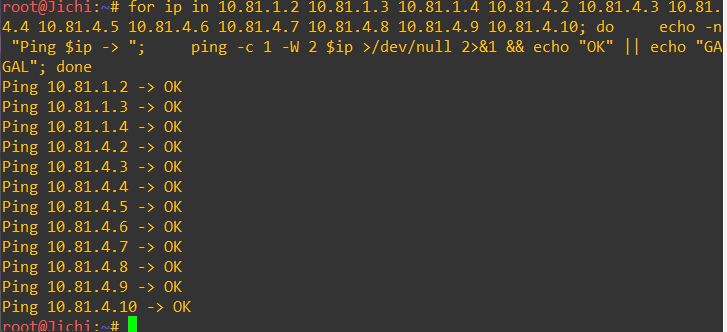

## Soal_2
Tengen, penjaga pusat distribusi di Data Center, harus mengambil alih pengalokasian alamat bagi wilayah yang membutuhkan konfigurasi dinamis. Konfigurasikan isc-dhcp-server pada [PREFIX IP].4.10. Deklarasikan Network 4 ([PREFIX IP].4.0/24) sebagai subnet lokal tanpa pool dinamis, lalu siapkan scope DHCP untuk Network 2 ([PREFIX IP].2.0/24) dan Network 3 ([PREFIX IP].3.0/24). Validasi konfigurasi dan pastikan service aktif tanpa error “No subnet declaration”.

Sebelum mulai kita perlu installasi pada console tengen. paket ini menyediakan dhcp.
```
apt update
apt install isc-dhcp-server -y
```

Selanjutnya kita perlu melakukan konfigurasi pada subnet
```
authoritative;

# Network 4 - subnet lokal tengen, TANPA pool dinamis
subnet 10.81.4.0 netmask 255.255.255.0 {
}

# Network 2 - Divisi A
subnet 10.81.2.0 netmask 255.255.255.0 {
    range 10.81.2.100 10.81.2.200;
    option routers 10.81.2.1;
    option subnet-mask 255.255.255.0;
    option broadcast-address 10.81.2.255;
    option domain-name-servers 192.168.122.1;

    default-lease-time 600;
    max-lease-time 3600;
}

# Network 3 - Divisi B
subnet 10.81.3.0 netmask 255.255.255.0 {
    range 10.81.3.100 10.81.3.200;
    option routers 10.81.3.1;
    option subnet-mask 255.255.255.0;
    option broadcast-address 10.81.3.255;
    option domain-name-servers 192.168.122.1;

    default-lease-time 600;
    max-lease-time 3600;
}
```

Testing
```
dhcpd -t -cf /etc/dhcp/dhcpd.conf
```
```
service isc-dhcp-server restart
service isc-dhcp-server status
```

```
ps aux | grep [d]hcpd
ss -ulpn | grep :67
```

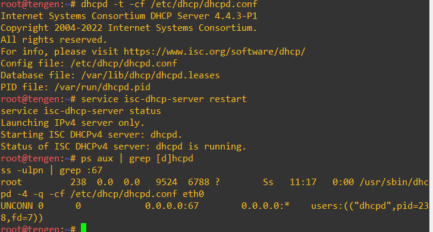

dhcpd -t hanya memeriksa sintaks tanpa menjalankan service. Debinet tidak memakai systemd, jadi status dicek dengan service dan dibuktikan lewat proses dhcpd serta port UDP 67 yang listening.

## Soal_3
Permintaan alamat dari Divisi A dan Divisi B tidak dapat menyeberangi subnet secara langsung. Konfigurasikan jichi sebagai DHCP Relay menuju tengen ([PREFIX IP].4.10), menggunakan eth2 untuk Network 2 dan eth3 untuk Network 3. Buktikan bahwa client dari kedua subnet berhasil memperoleh lease melalui relay.

DHCPDISCOVER dikirim client sebagai broadcast, dan broadcast tidak diteruskan router ke subnet lain. Client di Network 2 dan 3 tidak bisa menjangkau tengen yang ada di Network 4. DHCP Relay di jichi menangkap broadcast itu dan meneruskannya sebagai unicast ke tengen (10.81.4.10). Saat meneruskan, relay mengisi field giaddr dengan IP interface asal request (10.81.2.1 atau 10.81.3.1). Dari field itu tengen memilih scope yang cocok, yaitu subnet yang sudah kita deklarasikan di Soal 2. Balasan tengen dikirim ke relay, lalu diteruskan ke client.

Relay hanya meneruskan request. Kalau tengen mati atau jichi tidak bisa menjangkaunya, relay tidak ada gunanya. Forwarding dibutuhkan agar balasan unicast dari tengen bisa kembali lewat jichi.

Pada tengen service harus aktif
```
service isc-dhcp-server status
ps aux | grep [d]hcpd
```

Di jichi, IP forwarding harus aktif dan tengen harus terjangkau
```
sysctl net.ipv4.ip_forward
ping -c 2 10.81.4.10
```

Selanjutnya kita perlu melakukan instalasi DHCP Relay. DEBIAN_FRONTEND=noninteractive mencegah paket menampilkan dialog pertanyaan.
```
apt update
DEBIAN_FRONTEND=noninteractive apt install isc-dhcp-relay -y
```

Selanjutnya kita perlu melakukan konfigurasi relay
```
SERVERS="10.81.4.10"
INTERFACES="eth2 eth3 eth4"
OPTIONS=""
```
- SERVERS: adalah alamat DHCP Server tujuan, yaitu tengen.

- INTERFACES: berisi interface yang dipantau relay. Sesuai modul, daftar ini mencakup interface menuju client (eth2 untuk Network 2, eth3 untuk Network 3) dan interface menuju jaringan server (eth4 untuk Network 4), agar balasan dari tengen bisa diterima dan diteruskan.

- eth1 (DMZ) dan eth0 (NAT): tidak dimasukkan karena tidak ada client DHCP di sana.

Jalankan relay
```
service isc-dhcp-relay restart
service isc-dhcp-relay status
ps aux | grep [d]hcrelay
```
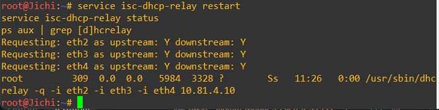

Berikutnya kita perlu melakukan uji dari client network 2 dan 3, contoh: itadori dan ino
itadori
```
ip addr flush dev eth0
ip link set eth0 up
udhcpc -i eth0 -n -q
ip -br a
ip route
cat /etc/resolv.conf
```
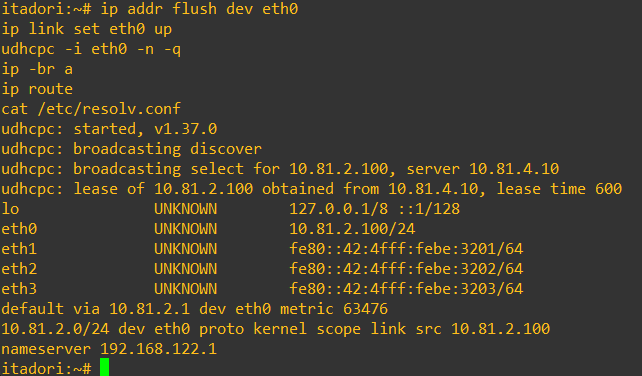

ino
```
ip addr flush dev eth0
ip link set eth0 up
udhcpc -i eth0 -n -q
ip -br a
ip route
cat /etc/resolv.conf
```
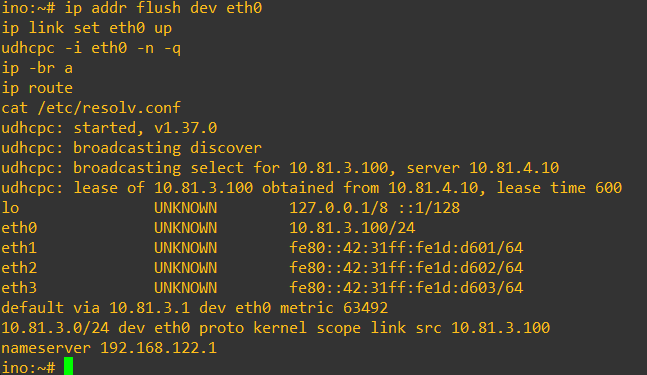

Selanjutnya untuk memberikan bukti lease
```
grep -E "lease|hardware|client-hostname" /var/lib/dhcp/dhcpd.leases
```
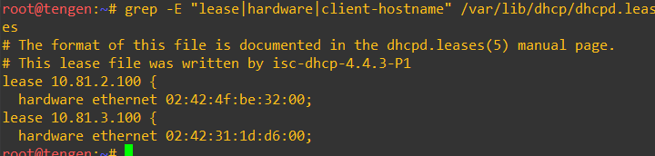

## Soal_4
Agar tim Dev dan Support di Divisi A menerima jatah alamat yang berbeda, atur dua pool DHCP pada Network 2. Tetapkan Pool 1 ([PREFIX IP].2.10–[PREFIX IP].2.35) untuk itadori dan fushiguro, serta Pool 2 ([PREFIX IP].2.70–[PREFIX IP].2.95) untuk zenin dan okkotsu. Rentang [PREFIX IP].2.36–[PREFIX IP].2.69 tidak boleh dialokasikan. Karena seluruh client berada pada subnet yang sama, gunakan DHCP class berdasarkan MAC Address atau Client ID untuk memisahkan kedua kelompok.

Semua client Network 2 berada di subnet yang sama, jadi server tidak bisa membedakan kelompok dari subnet-nya. Pembedanya adalah MAC Address client. Alurnya:

1. Class mengelompokkan client berdasarkan MAC (Pool 1: itadori dan fushiguro, Pool 2: zenin dan okkotsu).

2. Pool di dalam subnet dibatasi dengan allow members of "<class>", sehingga setiap pool hanya melayani class-nya.

3. Rentang .36 sampai .69 tidak ditulis di range mana pun, jadi tidak pernah dialokasikan. Range lama .100-.200 dihapus.

Pada tahap pertama kita perlu mengambil MAC Address Client Di itadori, fushiguro, zenin, dan okkotsu dengan `ip link show eth0`. MAC adalah identitas unik interface dan dikirim client di setiap paket DHCP (field Client Hardware Address), sehingga bisa dipakai server untuk menyaring.

itadori
```
63276: eth0: <BROADCAST,MULTICAST,UP,LOWER_UP> mtu 1500 qdisc fq_codel state UNKNOWN mode DEFAULT group default qlen 1000
    link/ether 02:42:4f:be:32:00 brd ff:ff:ff:ff:ff:ff
```

zenin
```
63281: eth0: <BROADCAST,MULTICAST,UP,LOWER_UP> mtu 1500 qdisc fq_codel state UNKNOWN mode DEFAULT group default qlen 1000
    link/ether 02:42:13:ec:82:00 brd ff:ff:ff:ff:ff:ff
```

fushiguro
```
63282: eth0: <BROADCAST,MULTICAST,UP,LOWER_UP> mtu 1500 qdisc fq_codel state UNKNOWN mode DEFAULT group default qlen 1000
    link/ether 02:42:08:2d:e1:00 brd ff:ff:ff:ff:ff:ff
```

okkotsu
```
63280: eth0: <BROADCAST,MULTICAST,UP,LOWER_UP> mtu 1500 qdisc fq_codel state UNKNOWN mode DEFAULT group default qlen 1000
    link/ether 02:42:94:57:ff:00 brd ff:ff:ff:ff:ff:ff
```

Selanjutnya kita perlu mengubah konfigurasi dhcp di tengen dengan MAC.
```
authoritative;

# Network 4 - subnet lokal tengen, tanpa pool dinamis
subnet 10.81.4.0 netmask 255.255.255.0 {
}

# Class pengelompokan berdasarkan MAC Address
class "pool1" {
    match if substring(hardware, 1, 6) = MAC-ITADORI
          or substring(hardware, 1, 6) = MAC-FUSHIGURO;
}

class "pool2" {
    match if substring(hardware, 1, 6) = MAC-ZENIN
          or substring(hardware, 1, 6) = MAC-OKKOTSU;
}

# Network 2 - Divisi A
subnet 10.81.2.0 netmask 255.255.255.0 {
    option routers 10.81.2.1;
    option subnet-mask 255.255.255.0;
    option broadcast-address 10.81.2.255;
    option domain-name-servers 192.168.122.1;

    default-lease-time 600;
    max-lease-time 3600;

    # Pool 1 - Dev (itadori, fushiguro)
    pool {
        range 10.81.2.10 10.81.2.35;
        allow members of "pool1";
    }

    # Pool 2 - Support (zenin, okkotsu)
    pool {
        range 10.81.2.70 10.81.2.95;
        allow members of "pool2";
    }
}

# Network 3 - Divisi B (tidak berubah)
subnet 10.81.3.0 netmask 255.255.255.0 {
    range 10.81.3.100 10.81.3.200;
    option routers 10.81.3.1;
    option subnet-mask 255.255.255.0;
    option broadcast-address 10.81.3.255;
    option domain-name-servers 192.168.122.1;

    default-lease-time 600;
    max-lease-time 3600;
}
```

Validasi dan restart
```
dhcpd -t -cf /etc/dhcp/dhcpd.conf
service isc-dhcp-server restart
service isc-dhcp-server status
ps aux | grep [d]hcpd
```
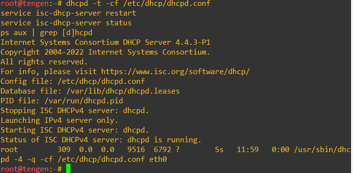

Testing
Untuk tahap selanjutnya kita perlu membuktikan rentang 36-69 tidak dialokasikan
```
grep -E "^lease|hardware" /var/lib/dhcp/dhcpd.leases
```
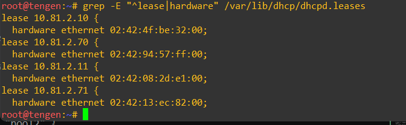

Pembagian pool pada subnet yang sama dilakukan dengan DHCP class berdasarkan MAC Address. Setiap class dikaitkan ke satu pool melalui allow members of, sehingga client kelompok Dev hanya menerima IP 10.81.2.10-35 dan kelompok Support hanya 10.81.2.70-95. Rentang 10.81.2.36-69 tidak dideklarasikan dalam range mana pun sehingga tidak pernah dialokasikan.

## Soal_5
Setiap tim lapangan memiliki durasi operasi yang berbeda. Pada Network 3, berikan short lease 30 menit (1800 detik) kepada ino dan kusakabe, serta long lease 12 jam (43200 detik) kepada miwa. Gunakan pool short lease [PREFIX IP].3.10–[PREFIX IP].3.89 dan pool long lease [PREFIX IP].3.100–[PREFIX IP].3.199. Sesuaikan default-lease-time dan max-lease-time untuk setiap kelas client. Berikan pula DHCP options berupa DNS [PREFIX IP].1.2 dan [PREFIX IP].1.3, serta domain-search <xxxx>.com.

Kelompok: K35 (K35.com)
Soal ini memakai pola yang sama dengan Soal 4: DHCP class berdasarkan MAC, lalu setiap class dikaitkan ke satu pool.

1. Class short (ino, kusakabe) memakai pool 10.81.3.10-89 dengan lease 1800 detik (30 menit).

2. Class long (miwa) memakai pool 10.81.3.100-199 dengan lease 43200 detik (12 jam).

3. default-lease-time adalah lease yang diberikan ke client, sedangkan max-lease-time adalah batas maksimum yang boleh diminta client. Keduanya saya samakan per class agar lease tepat 1800 dan 43200 detik.

4. Option DNS (10.81.1.2 utahime dan 10.81.1.3 shoko) dan domain-search (K35.com) berlaku untuk seluruh subnet, jadi ditulis di level subnet.

Pada tahap awal kita perlu mengubah kofigurasi dhcp pada tengen
```
authoritative;

# Network 4 - subnet lokal tengen, tanpa pool dinamis
subnet 10.81.4.0 netmask 255.255.255.0 {
}

# ===== Class Network 2 =====
class "pool1" {
    match if substring(hardware, 1, 6) = 02:42:4f:be:32:00
          or substring(hardware, 1, 6) = 02:42:08:2d:e1:00;
}

class "pool2" {
    match if substring(hardware, 1, 6) = 02:42:13:ec:82:00
          or substring(hardware, 1, 6) = 02:42:94:57:ff:00;
}

# ===== Class Network 3 =====
class "short" {
    match if substring(hardware, 1, 6) = MAC-INO
          or substring(hardware, 1, 6) = MAC-KUSAKABE;
    default-lease-time 1800;
    max-lease-time 1800;
}

class "long" {
    match if substring(hardware, 1, 6) = MAC-MIWA;
    default-lease-time 43200;
    max-lease-time 43200;
}

# Network 2 - Divisi A
subnet 10.81.2.0 netmask 255.255.255.0 {
    option routers 10.81.2.1;
    option subnet-mask 255.255.255.0;
    option broadcast-address 10.81.2.255;
    option domain-name-servers 192.168.122.1;

    default-lease-time 600;
    max-lease-time 3600;

    pool {
        range 10.81.2.10 10.81.2.35;
        allow members of "pool1";
    }

    pool {
        range 10.81.2.70 10.81.2.95;
        allow members of "pool2";
    }
}

# Network 3 - Divisi B
subnet 10.81.3.0 netmask 255.255.255.0 {
    option routers 10.81.3.1;
    option subnet-mask 255.255.255.0;
    option broadcast-address 10.81.3.255;
    option domain-name-servers 10.81.1.2, 10.81.1.3;
    option domain-search "K35.com";

    # Short lease: ino, kusakabe
    pool {
        range 10.81.3.10 10.81.3.89;
        allow members of "short";
    }

    # Long lease: miwa
    pool {
        range 10.81.3.100 10.81.3.199;
        allow members of "long";
    }
}
```

Selanjutnya agar ino, kusakabe, dan miwa tidak membawa lease lama dari range .100-200 kita perlu membersihkan lease lama
```
service isc-dhcp-server stop
> /var/lib/dhcp/dhcpd.leases
service isc-dhcp-server start
```
Selanjutnya untuk mendapatkan MAC client
```
ip addr flush dev eth0
ip link set eth0 up
udhcpc -i eth0 -n -q -O search
ip -br a
ip route
cat /etc/resolv.conf
```

Testing
```
grep -E "^lease|starts|ends|hardware" /var/lib/dhcp/dhcpd.leases
```


Pada Network 3 dibuat dua class berdasarkan MAC Address. Class short (ino dan kusakabe) memperoleh IP dari pool 10.81.3.10-89 dengan default-lease-time dan max-lease-time 1800 detik, sedangkan class long (miwa) dari pool 10.81.3.100-199 dengan lease 43200 detik. Seluruh client Network 3 menerima option DNS 10.81.1.2 dan 10.81.1.3 serta domain-search K35.com. Pembuktian dilakukan lewat output udhcpc, packet capture DORA, dan file dhcpd.leases.

## Soal_6
Kugisaki ditetapkan sebagai personel VIP yang harus mempertahankan alamat yang sama setiap kali terhubung. Buat DHCP static lease berdasarkan MAC Address client tersebut dengan fixed address [PREFIX IP].3.99. Pastikan alamat ini berada di luar seluruh pool dinamis, validasi konfigurasi server, lalu renew lease pada client. Buktikan bahwa alamat yang diterima sesuai dengan reservasi.

Fixed address (DHCP reservation) membuat server memberi IP yang selalu sama kepada client berdasarkan MAC Address-nya, lewat blok host. Ini berbeda dengan static IP, karena IP tetap diberikan oleh DHCP Server dan bukan diatur manual di client.

Pada tahap awal kita memerlukan MAC kugisaki 
```
eth0: <BROADCAST,MULTICAST,UP,LOWER_UP> mtu 1500 qdisc fq_codel state UNKNOWN mode DEFAULT group default qlen 1000
    link/ether 02:42:01:08:34:00 brd ff:ff:ff:ff:ff:ff
```

Tahap berikutnya kita menambahkan reservasi pada console tengen karena MAC di isi lewat variabel, lalu diperiksa formatnya sebelum dipakai.
```
MAC=02:42:01:08:34:00
echo $MAC | grep -Eq '^([0-9a-f]{2}:){5}[0-9a-f]{2}$' && echo "FORMAT MAC OK" || echo "FORMAT MAC SALAH"


cat >> /etc/dhcp/dhcpd.conf <<EOF

# Fixed address kugisaki (VIP), di luar pool dinamis
host kugisaki {
    hardware ethernet $MAC;
    fixed-address 10.81.3.99;
}
EOF

# cek hasilnya
grep -n -A4 'host kugisaki' /etc/dhcp/dhcpd.conf

# validasi dan restart
dhcpd -t -cf /etc/dhcp/dhcpd.conf
service isc-dhcp-server restart
ps aux | grep [d]hcpd
```

Selanjutnya buat DHCP static lease berdasarkan MAC kugisaki
```
ip addr flush dev eth0
ip link set eth0 up
udhcpc -i eth0 -n -q -O search
ip -br a
ip route
cat /etc/resolv.conf
```

Testing
Pada console tengen
```
grep -E "^lease|hardware|starts|ends" /var/lib/dhcp/dhcpd.leases
```

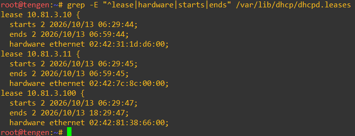

Kugisaki sebagai personel VIP diberi fixed address 10.81.3.99 melalui deklarasi host yang mengikat MAC Address-nya ke IP tersebut. Alamat ini berada di luar pool short lease (10.81.3.10-89) dan pool long lease (10.81.3.100-199), sehingga tidak berpotensi bentrok. Setelah konfigurasi divalidasi dengan dhcpd -t, renew lease pada client menghasilkan IP 10.81.3.99 yang sama setiap kali, dan lease tersebut tercatat di dhcpd.leases.

## Soal_7
Setelah aturan alokasi diterapkan, pastikan setiap client menerima konfigurasi jaringan sesuai wilayahnya: subnet mask 255.255.255.0 (/24), gateway dan broadcast address yang benar, DNS [PREFIX IP].1.2 serta [PREFIX IP].1.3, dan domain-search yang ditentukan. Periksa IP address dan routing seluruh client Divisi A dan Divisi B, kemudian cocokkan lease dengan /var/lib/dhcp/dhcpd.leases pada tengen. Pastikan tidak ada alamat yang bertabrakan atau berada di luar kebijakan pool.

Soal ini adalah tahap pembuktian. Tiga hal yang harus dibuktikan:

1. Setiap client menerima mask /24, gateway, broadcast, DNS, dan domain-search yang benar.

2. Lease di client cocok dengan dhcpd.leases di tengen.

3. Tidak ada IP bentrok dan tidak ada IP di luar kebijakan pool.

Pada tahap awal seluruh client Divisi A dan B menerima DNS 10.81.1.2, 10.81.1.3, dan domain-search K35.com. Kita perlu menambah konfigurasi DHCP pada console tengen.
```
    option domain-name-servers 10.81.1.2, 10.81.1.3;
    option domain-search "K35.com";
```

Selanjutnya kita perlu mencocokkan lease dengan /var/lib/dhcp/dhcpd.leases pada tengen. Pastikan tidak ada alamat yang bertabrakan atau berada di luar kebijakan pool.
```
ip addr flush dev eth0
ip link set eth0 up
udhcpc -i eth0 -n -q -O search
```

periksa IP, mask, broadcast, routing, dan DNS pada setiap client
```
ip -4 addr show eth0
ip route
cat /etc/resolv.conf
```

Buktikan bahwa domain-search dan lease time. contoh: ino dan itadori
Ino

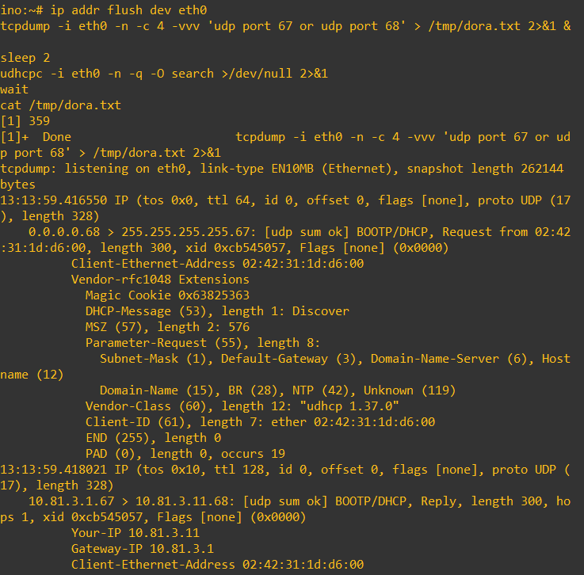

itadori

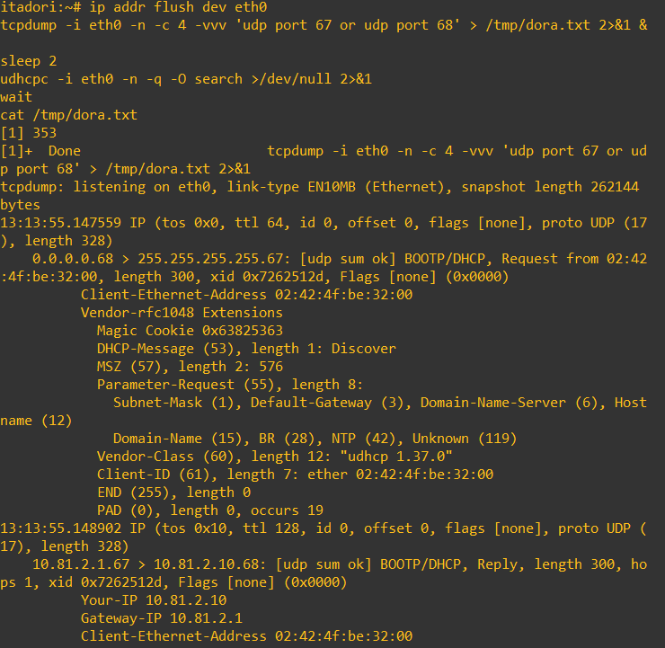

Testing
tahap terakhir yaitu periksa bentrok IP pada node tengen
```
# cocokkan dengan dhcp.lease pada tengen
grep -E "^lease|starts|ends|hardware ethernet" /var/lib/dhcp/dhcpd.leases

# periksa bentrok pada ip
grep -E "^lease" /var/lib/dhcp/dhcpd.leases | sort | uniq -d
```
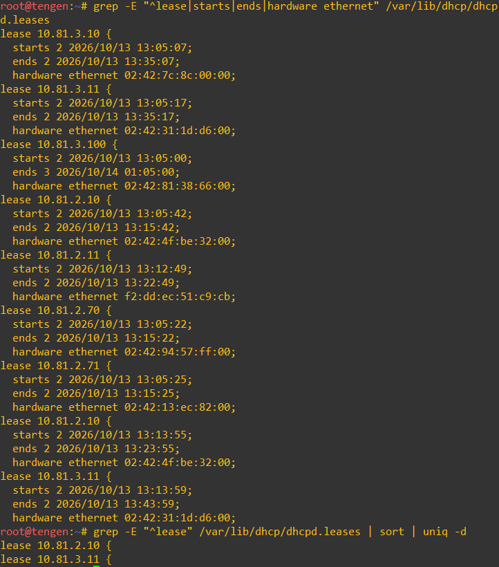

Setelah aturan alokasi diterapkan, setiap client diperiksa menerima konfigurasi sesuai wilayahnya. Client Divisi A menerima IP dari Pool 1 (10.81.2.10-35) atau Pool 2 (10.81.2.70-95) dengan gateway 10.81.2.1. Client Divisi B menerima IP dari pool short lease, pool long lease, atau fixed address 10.81.3.99 (kugisaki), dengan gateway 10.81.3.1. Seluruh client menerima subnet mask 255.255.255.0, broadcast address sesuai subnet, DNS 10.81.1.2 dan 10.81.1.3, serta domain-search K35.com. Lease di client dicocokkan dengan dhcpd.leases di tengen, dan hasilnya tidak ada IP bentrok maupun alamat di luar kebijakan pool.

## Soal_8
Sebelum Curtain dibuka kembali, buktikan bahwa proses pemberian alamat berjalan sesuai protokol. Lakukan packet capture saat salah satu client Network 2 atau Network 3 meminta lease baru. Gunakan tcpdump pada tengen atau jalur menuju Data Center untuk menunjukkan urutan DHCPDISCOVER → DHCPOFFER → DHCPREQUEST → DHCPACK. Identifikasi alamat server, alamat yang diberikan, lease time, dan field giaddr. Pastikan nilai giaddr sesuai dengan interface jichi yang menerima request dari subnet client.

Client berada di Network 2 sedangkan tengen di Network 4, jadi broadcast DISCOVER tidak bisa menyeberang router. jichi (DHCP Relay) menangkap broadcast itu lalu meneruskannya secara unicast ke tengen. Saat meneruskan, relay mengisi field giaddr (Gateway IP Address) dengan IP interface jichi yang menerima request dari client. Dari giaddr inilah tengen tahu:

1. Request berasal dari subnet mana, sehingga ia memilih pool 10.81.2.0/24.

2. Ke mana OFFER dan ACK harus dikirim, yaitu ke giaddr (relay), bukan broadcast.

Pada tahap awal kita perlu menyiapkan tcpdump di tengen. Sebelumnya kita cek apakah tcpdump sudah ada?
```
which tcpdump || (apt-get update -y && apt-get install -y tcpdump)
ip a
```

Selanjutnya kita mulai melakukan capture
```
tcpdump -i eth0 -n -vvv -c 4 'udp port 67 or udp port 68' 2>&1 | tee /root/dhcp-dora-K35.txt
```
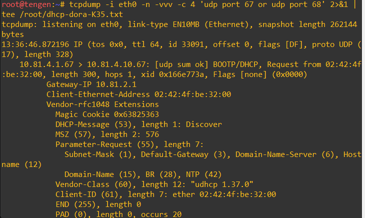

```
tcpdump -i eth0 -n -vvv -c 4 'udp port 67 or udp port 68' 2>&1 | tee /root/dhcp-dora-K35.txt
```

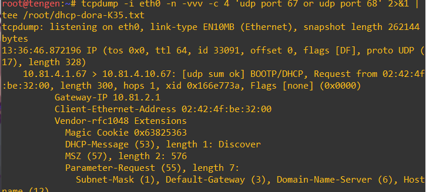

Selanjutnya kita meminta lease baru pada itadori. flush menghapus IP lama sehingga client memulai DORA dari awal. Setelah itu terminal tengen akan menampilkan 4 packet dan berhenti sendiri.
```
ip addr flush dev eth0
ip link set eth0 up
udhcpc -i eth0 -n -q
ip a show eth0
ip route
```

Selanjutnya kita perlu memastikan niali giaddr sesuai dengan interface jichi yang menerima request dari subnet client.
```
tcpdump -i eth2 -n -vvv -c 4 'udp port 67 or udp port 68'
```

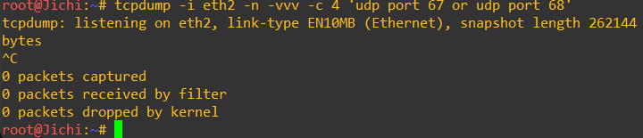

## Soal_9
Sebuah gangguan memutus jalur relay dan membuat permintaan alamat tidak sampai ke Data Center. Hentikan service DHCP Relay pada jichi, lalu paksa salah satu client di Network 2 atau Network 3 meminta lease baru dan catat gejalanya. Pulihkan service relay, ulangi permintaan DHCP, lalu buktikan bahwa client kembali memperoleh alamat dari pool yang benar dengan gateway semula.

Relay adalah satu-satunya penghubung antara client dan tengen. Broadcast DISCOVER dari itadori hanya sampai di jichi dan tidak akan diteruskan router ke Network 4. Jika service relay di jichi mati, tidak ada proses yang menangkap broadcast tersebut dan meneruskannya ke tengen. Akibatnya DISCOVER tidak pernah sampai ke Data Center, tidak ada OFFER yang kembali, dan client gagal mendapat lease. Ini menunjukkan bahwa IP forwarding saja tidak cukup untuk DHCP, karena broadcast tidak dirouting.

Pada langkah awal kita perlu mengencek baseline atau kondisi sebelum gangguan.

Jichi
```
service isc-dhcp-relay status
ps aux | grep dhcrelay

# henikan relay pada jichi
service isc-dhcp-relay stop
service isc-dhcp-relay status
ps aux | grep dhcrelay
```

itadori
```
ip a show eth0
ip route
```

Selanjutnya kita perlu melakukan capture pada tengen dan jichi, agar gejalanya terbukti, jalankan capture di dua tempat sebelum meminta lease.

tengen
```
tcpdump -i eth0 -n 'udp port 67 or udp port 68'
```

jichi
```
tcpdump -i eth2 -n 'udp port 67 or udp port 68'
```

Pada client itadori kita paksa untuk meminta lease baru. Hentikan kedua tcpdump jika sudah selesai
```
ip addr flush dev eth0
ip link set eth0 up
udhcpc -i eth0 -n -q -t 3 -T 3
ip a show eth0
ip route
```

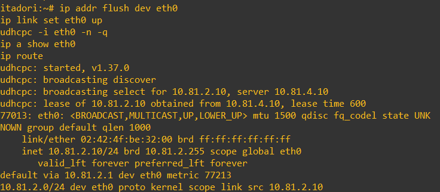

Selanjutnya kita perlu memulihkan relay pada jichi.
```
service isc-dhcp-relay start
service isc-dhcp-relay status
ps aux | grep dhcrelay
cat /etc/default/isc-dhcp-relay
```
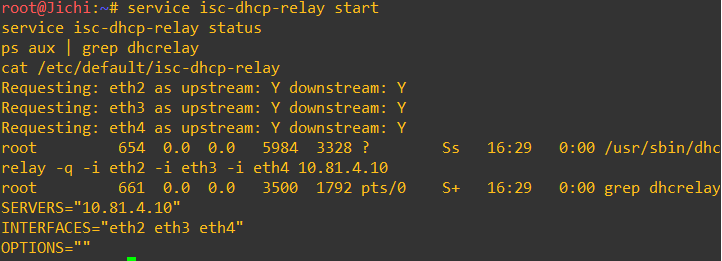


Testing
Jalankan capture di tengen
```
tcpdump -i eth0 -n -c 4 'udp port 67 or udp port 68'
```

pada itadori
```
ip addr flush dev eth0
ip link set eth0 up
udhcpc -i eth0 -n -q
ip a show eth0
ip route
```


## Soal_10
Setelah gangguan Shibuya tertangani, pastikan pemulihan bertahan setelah restart. Aktifkan autostart DHCP Server pada tengen dan DHCP Relay pada jichi, lalu restart kedua node. Verifikasi status layanan, IP, gateway, lease, dan konektivitas client Network 2–3. Pastikan kebijakan Pool 1, Pool 2, short lease, long lease, dan fixed address tetap berlaku.

Persistence berarti konfigurasi dan service tetap aktif setelah node restart, tanpa dijalankan ulang manual. Ada dua hal yang diuji:

1. Service: isc-dhcp-server (tengen) dan isc-dhcp-relay (jichi) harus otomatis berjalan.

2. Konfigurasi pendukung: IP statis, route, IP forwarding, dan NAT di jichi, serta IP statis tengen, harus kembali ada.

Untuk tahap awal kita perlu mengecek cara autostart yang tersedia pada node tengen dan jichi

tengen
```
systemctl is-enabled isc-dhcp-server
ls /etc/rc2.d/ | grep -i dhcp
tail -n 20 /root/.bashrc
```

jichi
```
systemctl is-enabled isc-dhcp-relay
ls /etc/rc2.d/ | grep -i dhcp
tail -n 30 /root/.bashrc
```

Pada tahap selanjutnya kita perlu mengaktifkan autostart pada node tengen dan jichi

tengen
```
systemctl enable isc-dhcp-server 2>/dev/null || update-rc.d isc-dhcp-server enable
```

jichi
```
systemctl enable isc-dhcp-relay 2>/dev/null || update-rc.d isc-dhcp-relay enable
```

Tahap selanjutnya kita mengecek untuk melihat status dhcp sebelum diubah

tengen
```
service isc-dhcp-server status
systemctl is-enabled isc-dhcp-server
ip a show eth0
dhcpd -t
```

jichi
```
service isc-dhcp-relay status
systemctl is-enabled isc-dhcp-relay
ip a
ip route
sysctl net.ipv4.ip_forward
iptables -t nat -L POSTROUTING -n
```

Catat isi lease saat ini pada node tengen.
```
grep -E "^lease|hardware ethernet|ends" /var/lib/dhcp/dhcpd.leases
```

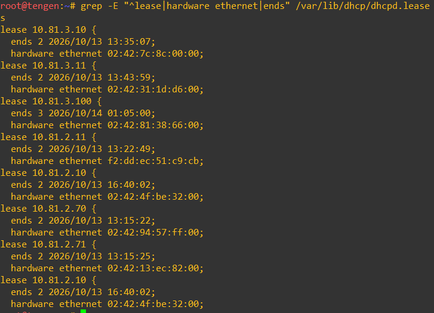

Tahap selanjutnya kita perlu melakukan restart kedua node
1. restart jichi dulu karena router harus siap duluan
2. setelah itu tengen
3. buka keduanya dan eksekusi

tengen
```
service isc-dhcp-server status >/dev/null 2>&1 || service isc-dhcp-server start
```

jichi
```
service isc-dhcp-relay status >/dev/null 2>&1 || service isc-dhcp-relay start
```

Selanjutnya verifikasi service dan jaringan pada kedua node.

jichi
```
service isc-dhcp-relay status
ps aux | grep dhcrelay
ip a
ip route
sysctl net.ipv4.ip_forward
iptables -t nat -L POSTROUTING -n
ping -c 2 10.81.4.<IP-tengen>
ping -c 2 8.8.8.8
```


tengen
```
service isc-dhcp-server status
ps aux | grep dhcpd
dhcpd -t
ip a
ip route
ping -c 2 10.81.4.1
```

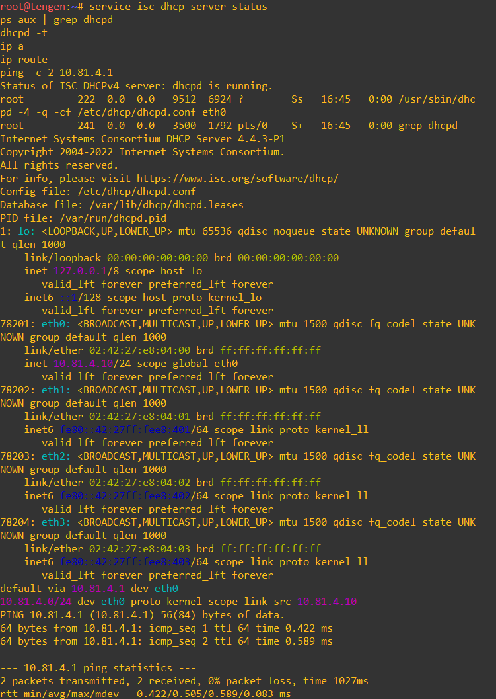

selanjutnya pada setiap client network 2 dan  kita perlu melakukan verivikasi meminta lease.
```
ip addr flush dev eth0
ip link set eth0 up
udhcpc -i eth0 -n -q
ip a show eth0
ip route
ping -c 2 <gateway-network-nya>
ping -c 2 8.8.8.8
```

Untuk melihat lease time pada client alternatifnya lihat di tengen
```
grep -E "^lease|starts|ends|hardware ethernet" /var/lib/dhcp/dhcpd.leases
```


## Soal_11
Utahime dan Shoko ditugaskan membangun sistem penamaan domain resmi agar seluruh pos tidak perlu menghafal alamat IP mentah. Konfigurasikan BIND9 pada utahime sebagai DNS Master dan shoko sebagai DNS Slave untuk mengelola domain jujutsu.<xxxx>.com. Atur SOA record, NS delegasi untuk kedua server, dan terapkan allow-transfer dari Master ke Slave. Pastikan file zona berhasil tersinkronisasi otomatis ke shoko saat nomor serial di utahime dinaikkan, lalu buktikan dengan melakukan query dig ke kedua server dari salah satu client.

Pertama, kita melakukan update dan install bind9 dahulu di node Utahime sebagai DNS Master.

```
apt-get update
apt-get install bind9 -y
ln -s /etc/init.d/named /etc/init.d/bind9
```
Kemudian, pada file ini dilakukan konfigurasi dengan mengaktifkan fitur notify dann allow-transfer ke DNS Slave yaitu Shoko.
```
mkdir /etc/bind/k35/k35.com
cat <<EOF > /etc/bind/named.conf.local
zone "jujutsu.k35.com" {
  type master;
  notify yes;
  also-notify { 10.81.1.3; };
  allow-transfer { 10.81.1.3; };
  file "/etc/bind/k35/jujutsu.k35.com";
};
EOF
```
Selanjutnya, konfigurasi utahime sebagai DNS Master.
mkdir /etc/bind/k35
```
cat <<EOF > /etc/bind/k35/jujutsu.k35.com
$TTL    604800          ; Waktu cache default (detik)
@       IN      SOA     utahime.k35.com. admin.k35.com. (
                        2026101201 ; Serial (format YYYYMMDDXX)
                        604800     ; Refresh (1 minggu)
                        86400      ; Retry (1 hari)
                        2419200    ; Expire (4 minggu)
                        604800     ; Negative Cache TTL
)

@       IN      NS      utahime.k35.com.
@       IN      NS      shoko.k35.com.
EOF
```

Untuk menyimpan perubahan, dilakukan restart.
```
service bind9 restart
```
Untuk memeriksa, kita melakukan test ping:
```
ping -c 5 jujutsu.k35.com
```
Pada DNS Slave yaitu Shoko, kita menginstall 

apt-get update
apt-get install bind9 -y
ln -s /etc/init.d/named /etc/init.d/bind9

cat <<EOF > /etc/bind/named.conf.local
zone "jujutsu.k35.com" {
    type slave;
    masters { 10.81.1.2; };
    file "/var/cache/bind/jujutsu.k35.com";
};
EOF

service bind9 restart